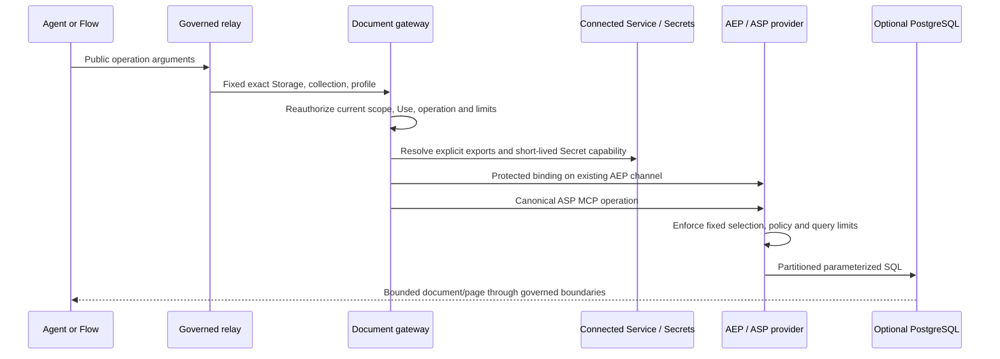

# Governed structured documents

The active [#1150](https://github.com/gbaudrit/agentstration/issues/1150) vertical
adds JSON documents and queries to ASP without changing the existing content
profile. PostgreSQL JSONB is an optional autonomous provider. Memory integration
[#1156](https://github.com/gbaudrit/agentstration/issues/1156) remains on hold.

## Contract and responsibilities

| Boundary | Responsibility |
|---|---|
| ASP Abstractions / Server / Client | `asp.documents/1`, canonical MCP schemas, exact logical selection, conditional document operations, query profile pins, protected cursors and optional immutable publication |
| ASP OData | Optional `odata/4.01@1.0` grammar/model binding through Microsoft.OData.Core; no generic public parser AST |
| AEP | Authenticated contribution discovery, typed capabilities and the existing protected `/aep/storage/bindings` exchange |
| Connected Service | Typed host, port, database, username and secured password exports; existing Parameter and Secret resolution |
| Storage | Exact implementation/service/export pins, common operation envelope and logical collection declarations |
| Infrastructure document gateway | Current scope, Use and permission checks; intersection and operation-specific narrowing; late AEP binding; audit and tracing |
| ToolDefinitions / relays | Explicit immutable Tool publication; fixed Storage revision, collection, policy and profile |
| Knowledge | Acquisition/projection composition, immutable publication, canonical Artifact materializations, exact Snapshot selection and retention leases |

No agent argument chooses a physical SQL schema, table, connection string or
credentials. A Storage Type binds compatible service exports explicitly; it does
not require that the Connected Service Type came from the same extension.



## Logical collections

Collections are bounded Storage configuration, rather than another resource or a
Data Source mode. A Data Source still owns governed acquisition. Each collection
declares `uid`, `name`, `displayName`, `enabled`, `schema` and `policy`.
The server assigns its UID. Removing and recreating the same name creates a new
identity and never reattaches old documents. Collection changes participate in the
Storage binding digest and require explicit reconciliation. Existing dependencies
continue to protect exact historical references.

The policy separates `get`, `put`, `delete`, `query`, `publish`, allowed profile
IDs and page/document/result limits. It can only narrow the Storage envelope.
Execution reuses `runs/execute` and the existing `resources/read`,
`resources/write` or `resources/delete` permission, plus scoped Resource Use.
No second permission registry is introduced.

## Query profiles

A request pins `{id, version, encoding, modelDigest}` from discovery. IDs and
encodings are open strings. An unknown version, encoding or model fails rather
than falling back. Other profiles can carry text encoded as JSON or structured
objects; the generic client, server and Tool query payload are not OData AST types.

The initial profile uses standard OData expressions in a JSON options object:

```json
{
  "$filter": "status eq 'degraded' and metrics/errorRate gt 0.1",
  "$orderby": "timestamp desc",
  "$select": "status,metrics/errorRate,timestamp"
}
```

The outer ASP request supplies `pageSize` and an optional opaque `cursor`. The
profile does not expose `$top`, `$skip`, SQL, joins, `$expand`, arbitrary functions
nested lambda captures or nested transformation pipelines. Supported features include comparisons,
`and`/`or`/`not`, bounded `in`, `contains`/`startswith`/`endswith`, `any`/`all`,
explicit selection, sort, and one simple aggregation:

```json
{
  "$apply": "groupby((service),aggregate($count as Count,metrics/errorRate with sum as Total))"
}
```

This is a bounded OData query profile over MCP, not a complete OData HTTP server.
Discovery states the subset. Sorting and grouping require declared scalar fields;
sum requires a declared number. An optional document JSON Schema builds the model.
The bounded supported schema keywords are `type`, `properties`, `required`,
boolean `additionalProperties`, `items`, `minimum`, `maximum`, `minLength`,
`maxLength`, `minItems`, `maxItems`, `enum` and annotations. One type plus optional
`null` is supported. Remote references and unsupported schema features fail
explicitly; validation never fetches a schema from a supplied URL.

Missing values compare as null. `eq null` matches missing and explicit null;
`ge`/`le` are true for two nulls, and other ordered null comparisons are false.
Non-null comparisons use JSON types without string-to-number coercion.
Numbers must be exactly representable as .NET decimal; strings use Unicode
code-point order. Sort adds document ID as a final ascending tie breaker, with
null first ascending and last descending. Mutable keyset pages may observe
concurrent writes; immutable Snapshot pages retain their sealed selection.

Limits are 64 expression nodes, depth 12, four sort keys, 32 in-list values,
16 selected paths, four grouping keys and eight aggregates. Documents are at most
64 KiB, results at most 192 KiB and pages at most 100 items, all further narrowed
by policy. Aggregate results fit one bounded page or fail explicitly. Request
payloads, parsing, SQL execution and cancellation remain bounded. Cursor integrity
binds caller/grant, StoreRef, collection/publication, exact profile/model, query
and page size. ASP cursors expire after five minutes; Knowledge continuations use
a shorter four-minute bound and an existing retention lease.

Get accepts an optional exact current revision. Put without `expectedRevision`
creates only; replacement and deletion require the current revision. Retrying an
uncertain mutation must preserve request ID, deadline and arguments. There is no
automatic mutation retry. Structured errors include conflict, unsupported profile,
invalid query/reference, schema validation, limit, timeout/cancellation and
unavailable exact version. Errors and traces do not log document bodies or Secrets.

## Optional PostgreSQL extension

Publish or run `src/Agentstration.Extensions.PostgreSql` independently, enroll it
through the existing AEP workflow and explicitly create its Connected Service and
Storage. The contributed `postgresql.jsonb@1.0.0` requirements are typed `host`,
`port`, `database`, `username` and secured `password`. No automatic connection or
Storage is created. Configuration is `{}`; the envelope contains document policy
fields. Enable desired write/delete/publication rights explicitly.

`PostgreSqlDocuments:AllowedClients` or explicitly allowed paired enrollment
governs transport callers. `AllowPairedClient` requires `Aep:EnrollmentMode` to be
`PairingCode`. Existing shared-key enrollment is also supported. Scope assignment verifies the
manifest using the existing registration Secret and passes that authenticated
manifest to the shared contribution provisioners. TLS defaults to
VerifyFull; `AllowLoopbackWithoutTls` applies only to an explicitly configured
loopback host. `ProvisionSchema=true` is an operator-owned setup option. Production
roles can instead receive the provisioned tables and DML rights separately from
the provisioning role.

The extension owns the `asp_jsonb` layout. Compound keys independently constrain
Store, binding, collection, publication and document. A path-ops GIN index supports
the extra containment predicate used for declared scalar equality. Typed range
and sort expressions can use bounded scans; SQL timeouts and collection limits
remain enforced. Operator tuning must be benchmarked against the actual workload.
Mutable collections admit at most 10,000 documents, retained publications at most
256 per collection, each with at most 100 documents. Retire old publications using
the governed producer lifecycle. Mutation receipts are transactionally persisted
and bounded; cleanup is incremental. Pools use at most four connections per exact
connection configuration, and SQL commands time out after ten seconds.

Aspire startup is opt-in with `PostgreSqlDocuments:Enabled=true`. It starts the
extension and reuses development AEP enrollment; it does not provision a database
or invent service bindings. The default product still runs without PostgreSQL.
The container distribution is `deploy/postgresql-documents/Dockerfile`.

Relational access to existing databases, governed SQL, JSONPath, full-text search,
pgvector, embeddings and hybrid Search are future profiles/capabilities. None is
required or exposed by this delivery.

## API, Tools and Console

Under `/api/storages/{name}/collections/{uid}`, with explicit `scopeRef` and
optional `namespace`, use `GET capabilities`, `GET documents/{id}`,
`POST documents`, `POST delete`, `POST query` and `POST tools/publish`.
Tool publication chooses explicit operations, a version and, for query, an exact
discovered profile. Metadata discovery intersects the authenticated contribution
and current policies without resolving Secrets or probing the physical database. Published Tools are assigned explicitly to agents or Flows;
they are not automatically granted. Draft and published document relays appear
as Storage dependencies and prevent destructive deactivation or rebinding. Query/write/delete rights are independently
restricted. Relay-fixed arguments cannot be replaced by caller JSON or the LLM.

The Storage editor declares collections and their rights/schema. Storage details
inspect effective capabilities, verify operations and explicitly publish a Tool.
All UI labels are available in en-US and fr-FR. An expired or uncertain mutation
retains its original identity for an explicit retry; changing the draft creates
a new request. Documents entered in the verification screen are persisted.

## Structured Knowledge

Select `documentCollectionUid` in the Knowledge output Storage. A projection
prepares one immutable collection publication, seals it, registers canonical JSON
Artifact materializations and then publishes the Snapshot. Hashes refer to
canonical JSON bytes, not the original lexical JSON. Input acquisition and Flow
provenance remain recorded.

Native `read`, `search_regex` and `get_status` remain available where supported.
The new `query_documents` Tool is published only when the actual output Storage,
collection policy and profile permit it; it fixes source identity and profile.
There is no consumer Knowledge put/delete capability. Exact historical queries
use the Storage, publication and model in the Snapshot evidence. A new active
publication never redirects an old Snapshot or cursor.

Use `POST /api/knowledgesources/{name}/content/query-documents` for native query
and `GET .../content/document-capabilities` for metadata discovery. Initial query
can prepare current data using the existing freshness/coalescing mechanism.
Continuation supplies only the protected cursor. Historical selection supplies
`snapshotId` and its matching profile. Existing read/query leases protect retained
content from retirement, subject to current authorization on every request.

## Deterministic validation

The provider test project runs the same MCP cases with a bounded memory fixture
and, when `AGENTSTRATION_TEST_ASP_POSTGRES` is set, a dedicated local PostgreSQL.
Product tests exercise real AEP contributions, late-bound Secrets, MCP, separate
agent relays, acquired JSON normalization and historical Snapshot queries. They
require neither an LLM nor internet access at execution time.

```bash
dotnet test --project tests/Agentstration.Extensions.PostgreSql.Tests -c Release
dotnet test --project tests/Agentstration.Api.Resources.Tests -c Release \
  --filter 'FullyQualifiedName~TwoAgentRelaysUseLateBoundExports|FullyQualifiedName~AcquiredJsonProjectsToImmutableStructuredKnowledge'
```

The PostgreSQL CI workflow supplies a disposable loopback database and runs the
real provider rows. Without the variable, optional PostgreSQL rows are explicitly
inconclusive; the deterministic memory path still executes. The separate reusable
UX journey [#1158](https://github.com/gbaudrit/agentstration/issues/1158) remains
blocked until maintainer UX approval and merge, as required by `AGENTS.md`.

See ADRs [0213](../decisions/0213-asp-document-capabilities-and-open-query-profiles.md),
[0214](../decisions/0214-bounded-standard-odata-query-profile.md),
[0215](../decisions/0215-logical-document-collections-remain-storage-configuration.md),
[0216](../decisions/0216-postgresql-jsonb-is-an-autonomous-asp-provider.md),
[0217](../decisions/0217-structured-snapshots-pin-immutable-document-publications.md)
and [0218](../decisions/0218-structured-storage-does-not-define-memory-policy.md).
