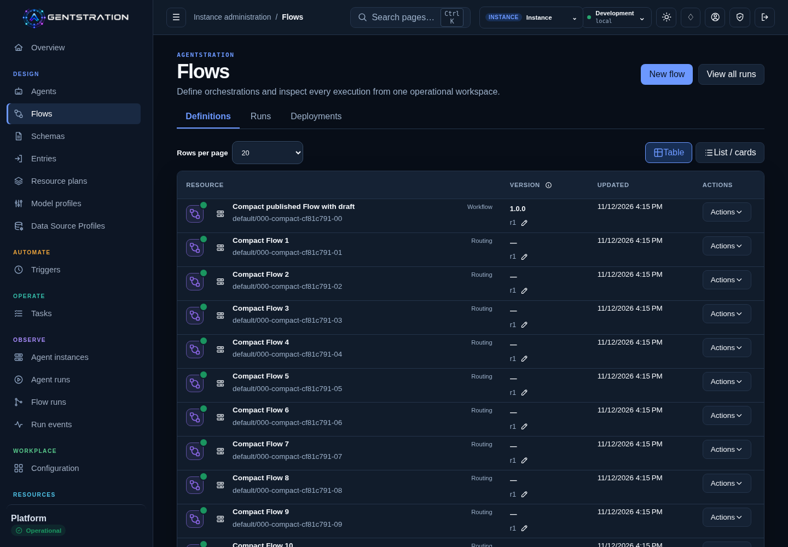
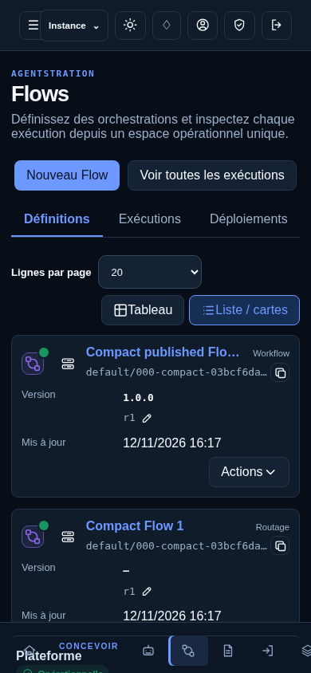

# Compact Flow prototype — real application evidence

These ten unedited viewport screenshots come from the real Console on product source `d8de2fa` (2026-11-12), using disposable local QA data and the existing governed inventory fixture. No mockup or generated image is used. The Local administrator selects the explicit Instance context so managed/inherited visibility is exercised under the actual scope policy. The draft rows are newly created through the Flow API; the first is published as `1.0.0` and retains its real draft revision `r1`.

| Variant | Existing managed/read-only resources | Version table | Version cards |
| --- | --- | --- | --- |
| Desktop · English · dark | [Managed](flows-managed-desktop-en-dark.png) | [Table](flows-table-desktop-en-dark.png) | [Cards](flows-cards-desktop-en-dark.png) |
| Desktop · English · light | [Managed](flows-managed-desktop-en-light.png) | [Table](flows-table-desktop-en-light.png) | [Cards](flows-cards-desktop-en-light.png) |
| Mobile · French · dark · touch | [Managed](flows-managed-mobile-fr-dark.png) | — | [Cards](flows-cards-mobile-fr-dark.png) |
| Mobile · French · light · touch | [Managed](flows-managed-mobile-fr-light.png) | — | [Cards](flows-cards-mobile-fr-light.png) |

All **four final prototype cases passed**, zero failures/skips/flakes. They verify the complete 20-row first page and 20-row offset page against real API responses, next/previous availability, changing to 50 rows and resetting to page one, unknown total, exact qualified copy, number alignment and the adjacent draft pencil. Geometry assertions verify the status dot at the family icon’s top-right corner, the read-only lock at its bottom-right corner, copy adjacent to the qualified name, desktop copy visibility on hover/focus and permanent touch visibility. Hover, focus, actual touch activation, Escape, action-menu keyboard navigation/focus, no accidental navigation and the real exact resource-name destination are exercised. The earlier four maintained cross-family version/primary-choice checks also passed; see [their recorded output](maintained-checks.txt).

[Structured results and image checksums](results.json). [Design, semantics and adoption boundary](../../../flow-compact-1121.md). Only Flows Definitions adopts this compact presentation pending explicit UX validation. Both implementation and coverage PRs remain drafts; no acceptance or merge is implied.
