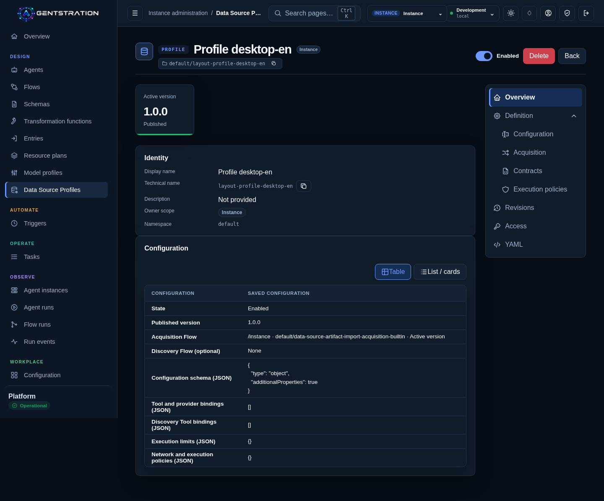
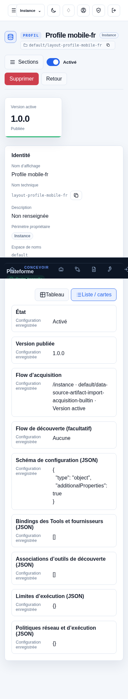
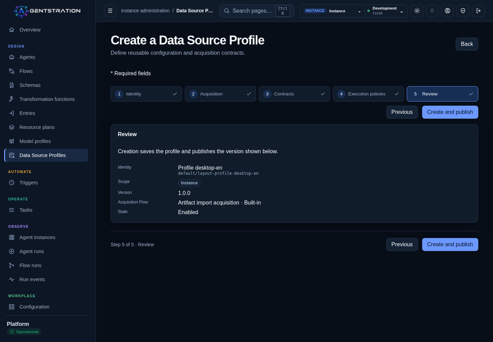
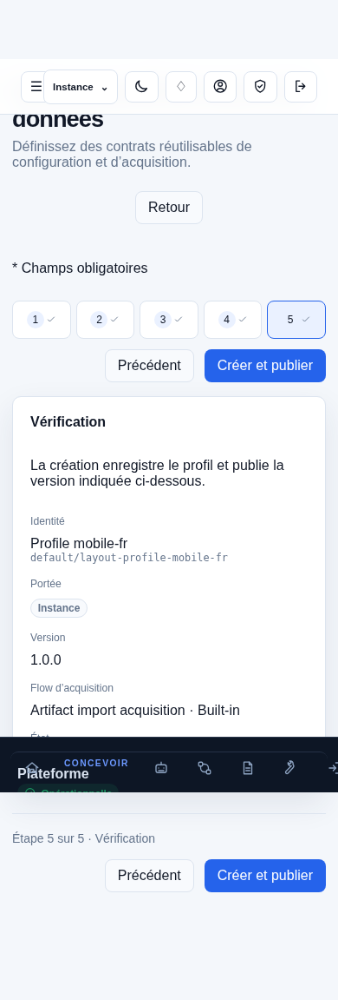
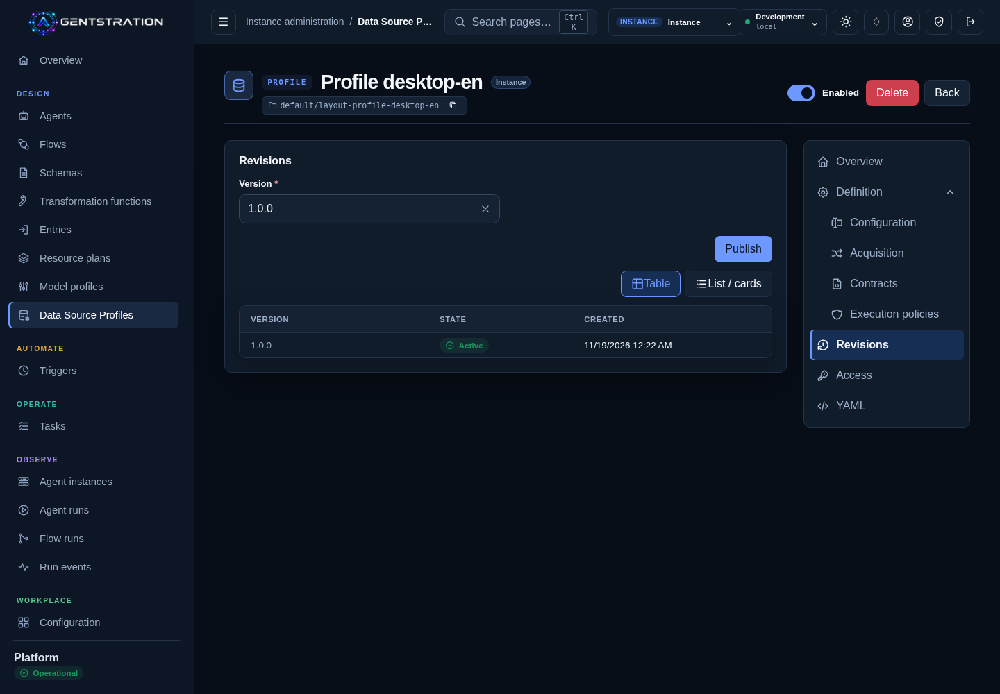
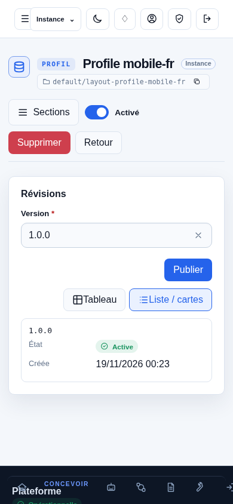

# Data source profiles — real application evidence

Application built from `f592c6f2570d1ffb3b86b20f77aaf6648adec240`. Desktop: en-US, dark, 1440 × 1000. Mobile: fr-FR, light, 390 × 844 with touch enabled and real wizard taps.

Creation and publication, saved overview and actual revision list. The maintained lifecycle regression also verifies update, publication, activation, rollback, acquisition provenance and scope/authorization boundaries.

[Validation and limits](validation.json). Earlier failed attempts used broad selectors that also matched retained hidden content; the current probes retain the same assertions and target the visible revision list. These images are application captures.

