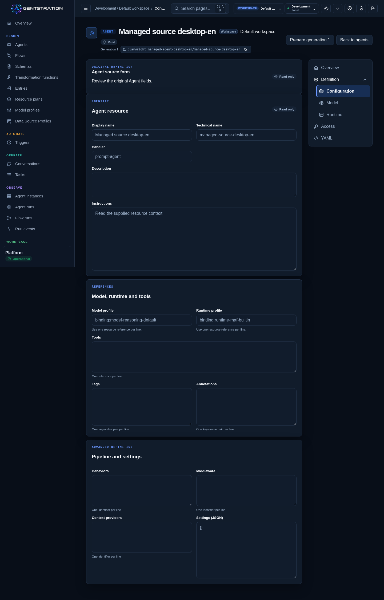
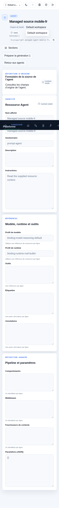
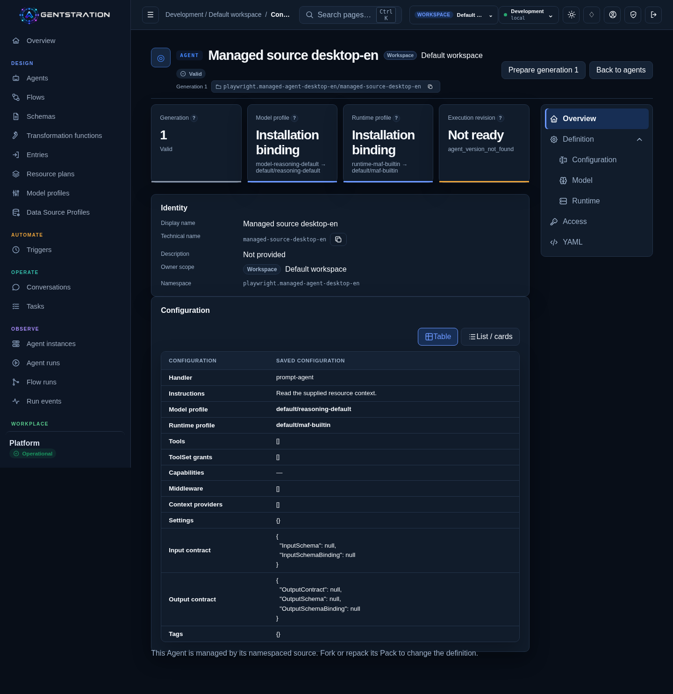
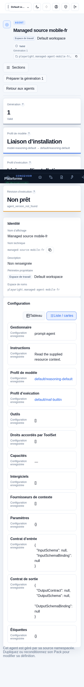
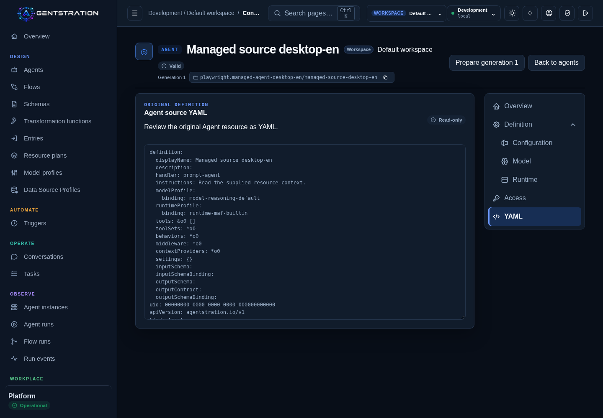
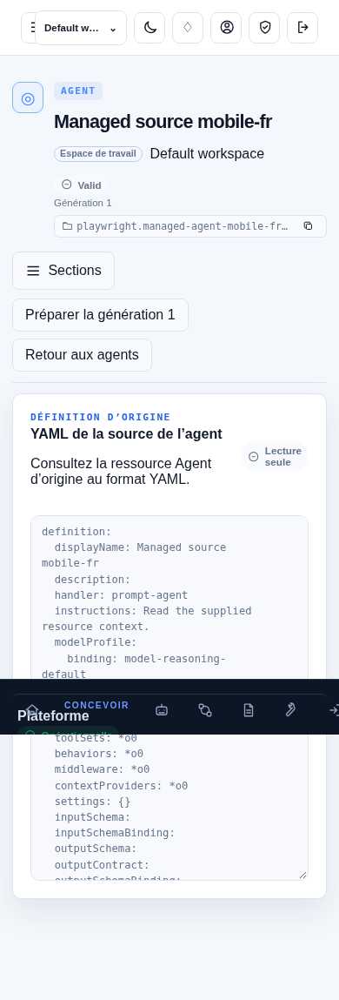

# Managed Agents — real application evidence

Application built from `41522385906ad435267e740e0c21018801edd6d4`. Six original captures: desktop en-US dark (1440 × 1000) and touch-enabled mobile fr-FR light (390 × 844).

The fixture creates and installs a real Pack with explicit, authorized Model and Runtime bindings. The screen retains the exact owner and original read-only Pack source. [Validation and limits](validation.json).

