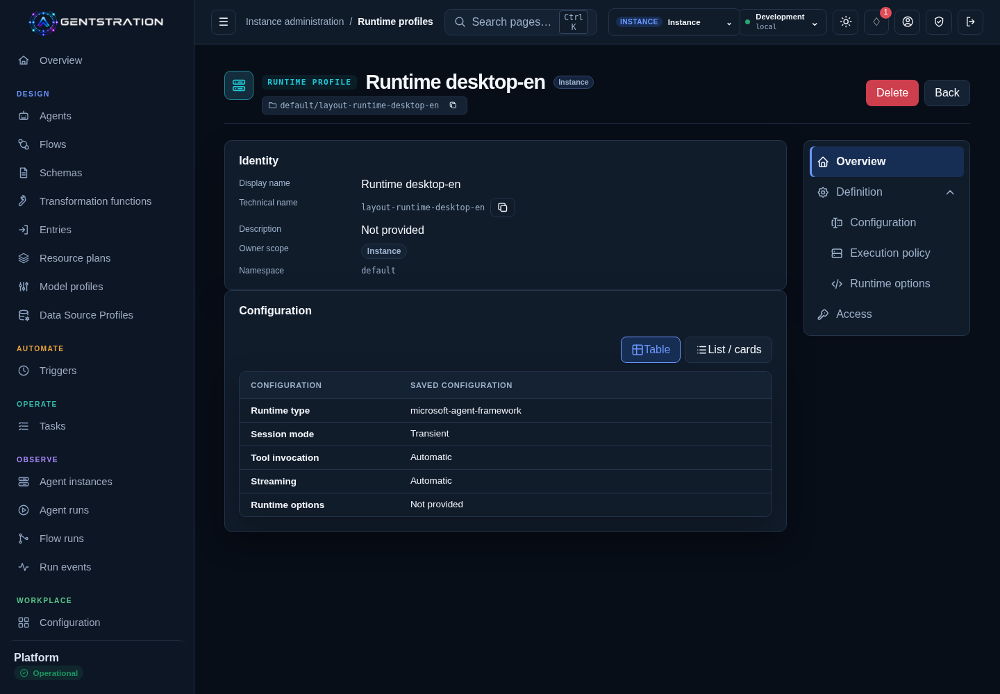
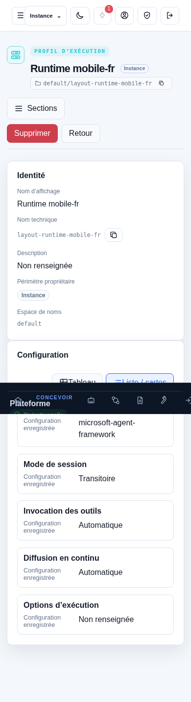

# Runtime profiles — real application evidence

Application built from `f592c6f2570d1ffb3b86b20f77aaf6648adec240`. Desktop: en-US, dark, 1440 × 1000. Mobile: fr-FR, light, 390 × 844 with touch enabled and real wizard taps.

Runtime creation, saved overview, invalid options retained through section navigation and explicit discard.

[Validation and limits](validation.json). Earlier failed attempts used broad selectors that also matched retained hidden content; the current probes retain the same assertions and target the visible revision list. These images are application captures.

