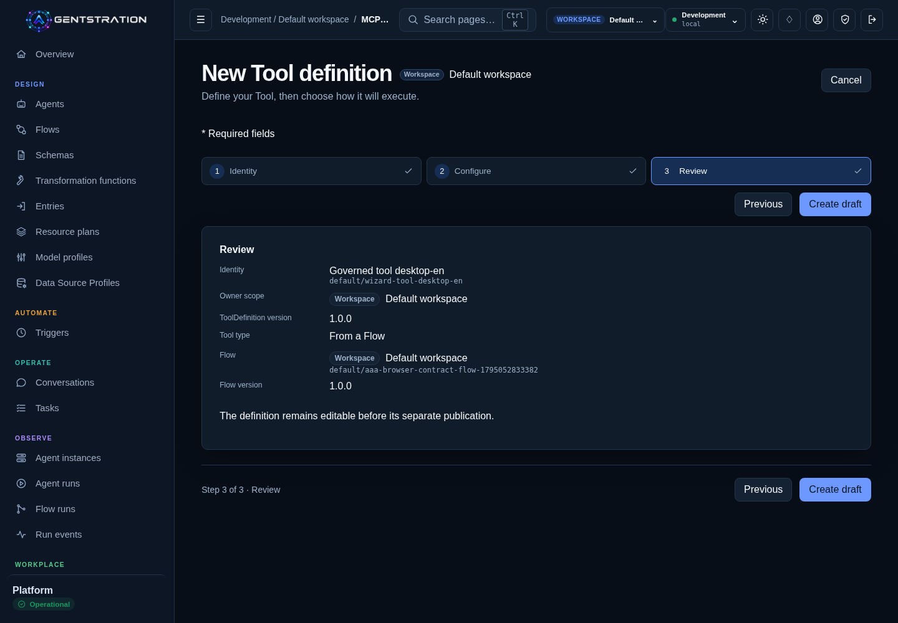
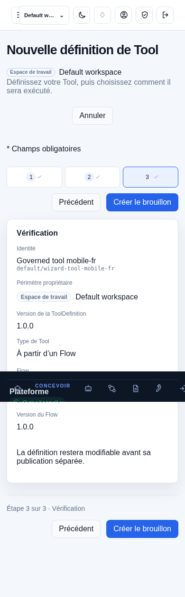

# Tool creation — real application evidence

Application built from `c27c8c821b82bb1faf43a36c72e781b6d2cb85fa`. Desktop en-US dark (1440 × 1000); mobile fr-FR light (390 × 844, touch-enabled browser).

Create a real unpublished Flow-backed ToolDefinition through Identity, Configure and Review. Verify the exact saved Flow owner/version and publication flag through the API. [Validation and limits](validation.json).

